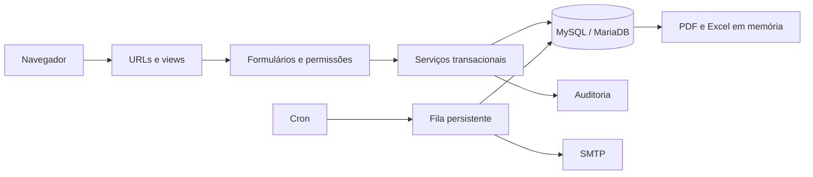

# 002 — Arquitetura e dependências

[Guia](001_GUIA_DA_DOCUMENTACAO.md) · Base documental 1.0.0.

Aplicação Django com templates no servidor e JavaScript local na planilha interativa. O banco operacional é MySQL/MariaDB; SQLite é restrito aos testes. Não há SPA separada, Redis, Celery, Docker ou AG Grid implementados.

## Estrutura

| Local | Responsabilidade |
| --- | --- |
| `config/` | Settings únicos, URLs raiz, WSGI e ASGI |
| `apps/accounts/` | Usuário próprio, autenticação, permissões e gestão |
| `apps/core/` | Base dos registros, início e filtro de templates |
| `apps/projetos/` | Obras, etapas, contatos, financeiro e Excel |
| `apps/orcamentos/`, `apps/despesas/` | Modelos financeiros |
| `apps/envios/` | Lotes, snapshots, tentativas e SMTP |
| `apps/relatorios/`, `apps/auditoria/` | Períodos e histórico |
| `utils/` | Decimais, documentos, datas, PDF e OOXML |
| `templates/`, `static/` | Interface e arquivos públicos locais |
| `media/modelos/projeto.xlsm` | Modelo permanente de exportação |
| `.codex/scripts/`, `.codex/tests/` | Manutenção e testes JavaScript |
| `.codex/versao/`, `.documentacao/` | Histórico e documentação atual |

[manage.py](../manage.py) executa comandos; [passenger_wsgi.py](../passenger_wsgi.py) é a entrada cPanel; [WSGI](../config/wsgi.py)/[ASGI](../config/asgi.py) são entradas convencionais. Não contêm regras financeiras. [config/urls.py](../config/urls.py) delega aos módulos.

## Bibliotecas

Versões transcritas de [requirements.txt](../requirements.txt), sem atualização de pacotes nesta consolidação.

| Biblioteca | Versão | Uso |
| --- | --- | --- |
| Django | 5.2.19 | ORM, transações, migrações, forms, sessões, auth, admin e templates |
| mysqlclient | 2.3.1 | Driver MySQL/MariaDB |
| python-dotenv | 1.2.4 | `.env`, preservando precedência do processo |
| dj-database-url | 3.1.2 | Converte DATABASE_URL em settings de banco |
| ReportLab | 5.1.0 | PDF e fontes Vera do pacote |
| WhiteNoise | 6.12.0 | Estáticos, compressão e nomes com hash |
| tzdata | 2026.2 | Fusos horários |
| openpyxl | 3.1.5 | Leitura XLSX/XLSM e utilitários de datas/coordenadas |
| xlrd | 2.0.2 | Leitura XLS binário |
| defusedxml | 0.7.1 | Proteção XML na leitura de planilhas |

A exportação modifica ZIP/XML com `zipfile` e `xml.etree.ElementTree`; não salva o XLSM através de openpyxl. `decimal`, `datetime`, `zoneinfo`, `uuid`, `hashlib`, `smtplib`, `logging`, `pathlib` e `io` são da biblioteca padrão. Decimais no JSON financeiro são texto para preservar centavos no navegador.

Bootstrap 5.3.8 e licença estão em `static/vendor/`. JavaScript usa APIs nativas e BigInt para dinheiro. Node executa testes, não o servidor Django. `djlint==1.36.4` é ferramenta opcional de formatação; `xlwt==1.3.0` gera fixtures XLS. Passenger e Cron vêm do provedor. Bibliotecas nativas de mysqlclient precisam existir no plano. WeasyPrint/Pango e caminhos de DLL foram substituídos por ReportLab.

## Requisição e efeitos

Segurança/WhiteNoise → sessão → CSRF → autenticação → redefinição obrigatória → view → formulário/permissão → serviço → validação/modelo → auditoria. Falha na transação desfaz seus dados e histórico. SMTP ocorre fora da transação de reserva da tentativa.

PDF e Excel são gerados em memória. O modelo XLSM é permanente; uploads e relatórios não são arquivados permanentemente pelo fluxo. Operação no [010](010_CONFIGURACAO_INSTALACAO_E_OPERACAO.md); referência das funções no [012](012_REFERENCIA_DE_FUNCOES.md).
