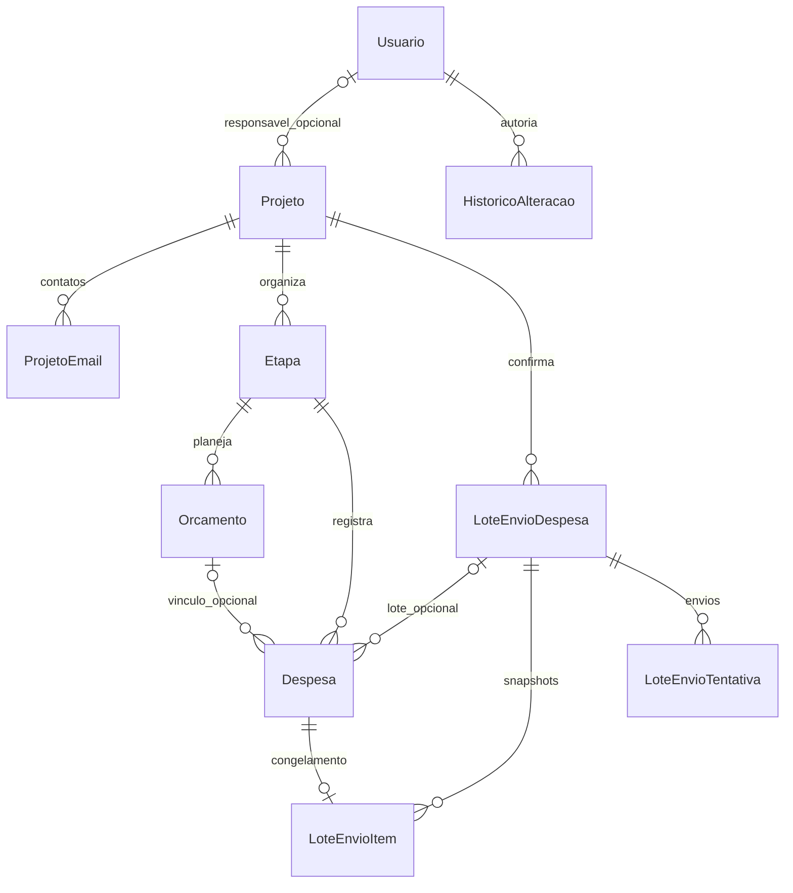

# 003 — Modelos e regras de dados

[Guia](001_GUIA_DA_DOCUMENTACAO.md) · Base documental 1.0.0.

As FKs de negócio usam proteção contra exclusão. Não há projeto duplicado na despesa: sua obra é alcançada pela etapa. Orçamento e despesa precisam pertencer à mesma etapa; lote e despesa, ao mesmo projeto.

## Cadastros mutáveis

| Modelo / fonte | Dados e finalidade |
| --- | --- |
| [Usuario](../apps/accounts/models.py) | AbstractUser, telefone, cargo, seis flags, versão e redefinição de senha |
| [RegistroNegocio](../apps/core/models.py) | Base abstrata com ativo, versão, timestamps e criador; save executa full_clean |
| [Projeto](../apps/projetos/models.py) | Nome, cliente, documento, endereço, tipo, RG/IE, arquiteto, tamanho, taxa, responsável, datas, status e SHA-256 de importação |
| ProjetoEmail | Contato normalizado e único por projeto, preservado na inativação |
| Etapa | Título, detalhe e ordem dentro do projeto |
| [Orcamento](../apps/orcamentos/models.py) | Descrição, quantidade, unidade, preço, composição opcional de custo, ordem e rascunho |
| [Despesa](../apps/despesas/models.py) | Etapa, orçamento/lote opcionais, fornecedor/documento, descrição, NF, emissão, vencimento, valor, observação e rascunho |

Status de Projeto: EM_ANDAMENTO, CONCLUIDO e CANCELADO. O formulário de capa não altera status. A existência das opções não significa que há ações de conclusão/cancelamento implementadas na tela atual.

Quantidade usa quatro casas; preços/despesas, duas; taxa admite quatro no banco e apresentação com duas. Constraints e validadores impedem valores negativos nos campos financeiros especificados. CPF/CNPJ usa normalização e dígitos verificadores, incluindo CNPJ alfanumérico.

Orçamento é completo com descrição, quantidade e valor unitário; `total` é zero em rascunho, senão quantidade × preço arredondado. `clean` soma mão de obra e material quando algum componente está informado. Despesa é rascunho sem fornecedor e valor positivo. Rascunho, inatividade e envio são dimensões distintas.

## Histórico

| Modelo / fonte | Finalidade |
| --- | --- |
| [LoteEnvioDespesa](../apps/envios/models.py) | Confirma projeto, data, autor, modalidade, despesas, taxa calculada/aplicada, justificativa, total, destinatários, layout, UUID e origem importada |
| LoteEnvioItem | Despesa, ordem, JSON e valor congelados; uma nota possui um snapshot de confirmação |
| LoteEnvioTentativa | UUID, tipo inicial/automático/manual, destinatários, agenda, início/fim, resultado, erro e solicitante |
| [HistoricoAlteracao](../apps/auditoria/models.py) | Entidade, objeto, projeto quando identificável, usuário, ação, antes/depois, justificativa, correlação e data |

Campos financeiros confirmados são imutáveis em `RegistroHistorico` e seu queryset. Status de e-mail, contadores, reservas e agendas são operacionais e atualizáveis. Auditoria não permite edição/exclusão. Essas proteções de aplicação não equivalem a impedir alterações SQL feitas diretamente por um administrador do banco.

Dados cadastrais da obra nos relatórios vêm da raiz atual. Notas, valores e destinatários confirmados continuam históricos. Não há cópia cadastral da obra nos lotes.

## Estado e concorrência

O queryset base impede exclusão e operações em massa que contornariam as validações. Serviços aumentam `versao`; o cliente envia a versão lida. Uma divergência impede sobrescrita silenciosa.

Inativos permanecem armazenados. Uma etapa com despesas ativas não pode ser inativada; filhos de etapa inativa não podem ser alterados. Reativar nota preserva lote e snapshot. As justificativas seguem o [fluxo 005](005_PROJETOS_ETAPAS_ORCAMENTOS_E_DESPESAS.md).

Orçado = itens ativos completos de etapas ativas + taxas confirmadas. Realizado = despesas ativas com valor em etapas ativas + taxas confirmadas. Saldo = orçado − realizado. Execução = realizado/orçado × 100; orçado zero produz zero. Filtros visuais não modificam totais oficiais.

## Migrações existentes

| Grupo | Evolução |
| --- | --- |
| accounts.0001–0004 | Usuário/manager, Administrativo e redefinição das senhas legadas |
| projetos.0001–0004 | Base, responsável FK com texto antigo preservado, tamanho, metadados e hash Excel |
| orcamentos.0001–0002 | Item e composição/constraints |
| despesas.0001–0003 | Registro/vínculos e vencimento |
| envios.0001–0003 | Lotes/fila, remoção da cópia cadastral e origem importada |
| auditoria.0001 | Histórico |

Nenhuma migração foi criada nesta consolidação. Reverter `envios.0002` não recupera cópias cadastrais removidas. Métodos e propriedades estão explicados no [catálogo 012](012_REFERENCIA_DE_FUNCOES.md).
