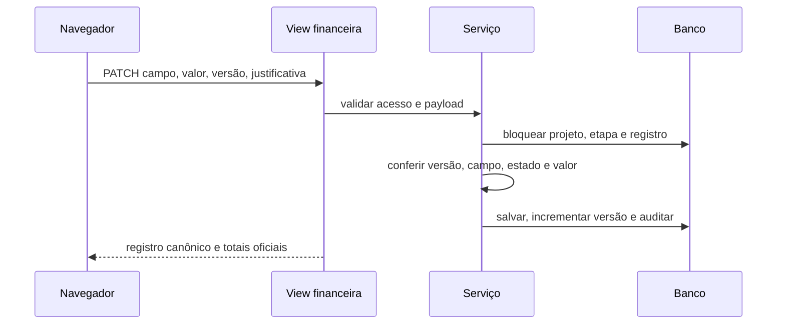

# 005 — Projetos, etapas, orçamentos e despesas

[Guia](001_GUIA_DA_DOCUMENTACAO.md) · [Views](../apps/projetos/views.py) · [Serviços](../apps/projetos/utils.py) · [Formulários](../apps/projetos/forms.py).

## Entrada e navegação

`core.inicio` calcula quatro cards: todos os projetos cadastrados; projetos ativos em andamento; quantidade e valor das despesas elegíveis ainda sem lote. Rascunhos/inativas/notas já confirmadas não entram nos dois últimos. A lista de obras da página inicial compartilha a tabela de Projetos.

`projetos.listar` abre Por responsável. Pastas representam responsáveis com projetos ativos; Sem responsável preserva acesso aos antigos sem FK. Responsáveis inativos continuam representados quando têm obras ativas. Cada pasta abre Em Andamento ou Finalizadas (CONCLUIDO e CANCELADO). Todos os projetos ignora o filtro de responsável/situação anterior.

As duas abas usam `_lista_filtrada.html` e `_tabela_lista.html`. Título filtra nome da obra; Cliente filtra cliente_contratante, combinados por AND. Grade 5/5/2; 25 registros por página; nome/ID estabilizam a ordenação. Limpar mantém a pasta; paginação mantém filtros. Pasta inválida retorna 404. Projetos inativos não entram nessas listas.

## Capa e contatos

`novo/editar` validam ProjetoForm e chamam `salvar_projeto`. O serviço verifica acesso, bloqueia a versão atual na edição, confere responsável e grava capa, contatos e auditoria na mesma transação. Emails ausentes da nova lista são inativados, não apagados. Duplicatas ou endereços inválidos são rejeitados.

Nome e observação ocupam linhas inteiras; cliente/documento e endereço/emails são pares; taxa, início, término previsto e tamanho ocupam quartos. Tipo, RG/IE e arquiteto complementam os dados. Taxa é apresentada com duas casas. Status não está no formulário; criação usa Em andamento. Tamanho vazio assume zero.

O responsável é FK opcional no modelo. Seleção vazia em novo projeto atribui o cadastrante; editar um legado vazio não faz essa atribuição automática. A regra de troca está no [004](004_AUTENTICACAO_PERMISSOES_E_USUARIOS.md).

## Fluxo da planilha

Geral mostra agrupamentos de etapas/itens inicialmente fechados. Orçamento permite criar e reordenar etapas/itens. Nova etapa retorna `url_orcamento` e abre a tela exclusiva para cadastrar itens; o acesso posterior fica na aba Orçamento. Despesas podem ser vinculadas a itens ou ficar em Demais Despesas. O resumo de Demais Despesas usa orçado zero, realizado das notas correspondentes e saldo negativo desse realizado.

`estrutura_projeto` é a representação compartilhada entre HTML inicial e respostas Fetch. Inclui versões, rascunhos, ativo, totais e taxas de lotes normais; omite taxas automáticas dos importados. Consultas prefetch evitam buscar cada relação individualmente. Totais são calculados com Decimal em [totais_projeto](../apps/projetos/utils.py).

## Contrato HTTP financeiro

Prefixo: `/projetos/<pk>/`. Os nomes/caminhos completos estão em [urls.py](../apps/projetos/urls.py).

| Rota | Método | Dados / resultado |
| --- | --- | --- |
| `dados/` | GET | Estrutura atual; `inativos=1` inclui registros na representação |
| `linhas/` | POST | `tipo`, `etapa` quando aplicável e campos permitidos; cria registro, retorna 201 |
| `linhas/<tipo>/<registro_id>/` | PATCH | `campo`, `valor`, `versao`, `justificativa` |
| `linhas/<tipo>/<registro_id>/estado/` | POST | `ativo`, `versao`, `justificativa` |
| `ordem/` | POST | `tipo`, `etapa`, `ids` ou `restaurar` |
| `historico/` | GET | Histórico com filtros `tipo/id`, 100 registros/página |

`api_financeira` converte falhas esperadas em JSON; conflito de versão e justificativa obrigatória têm tratamento próprio no cliente. JSON deve ser objeto, não array; propriedades extras são recusadas. IDs, tipos de registro e campos obedecem listas permitidas. Valores decimais devem chegar como texto, não float. A FK de orçamento é conferida dentro da mesma etapa/projeto.

`criar_registro` pode produzir rascunhos. `editar_celula` exige justificativa quando a despesa tem lote ou quando o orçamento tem despesas. Editar valor_unitario limpa a composição de custos importada para não sobrescrever o preço novo. Inativar etapa/despesa, reativar qualquer registro ou inativar orçamento com despesas exige justificativa. A etapa não pode ser inativada com notas ativas. Não há exclusão física nessas operações.

`reordenar` aceita apenas etapas/itens do agrupamento, sem duplicatas e cobrindo os ativos. `restaurar` remove a ordem manual; ordenação textual considera a chave sem acentos. Despesas não têm ordenação manual persistente.

O [catálogo 012](012_REFERENCIA_DE_FUNCOES.md) descreve separadamente as funções de validação, serialização, bloqueio e escrita. O [009](009_INTERFACE_TEMPLATES_E_JAVASCRIPT.md) explica fila local, salvamento e filtros do navegador.
